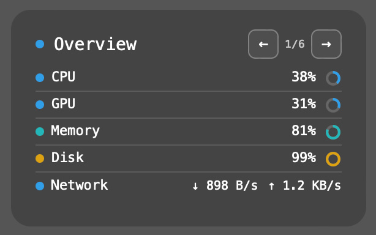
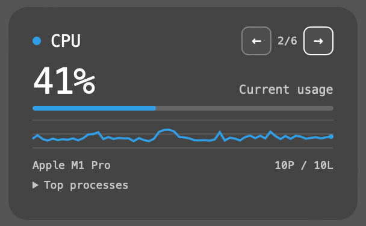
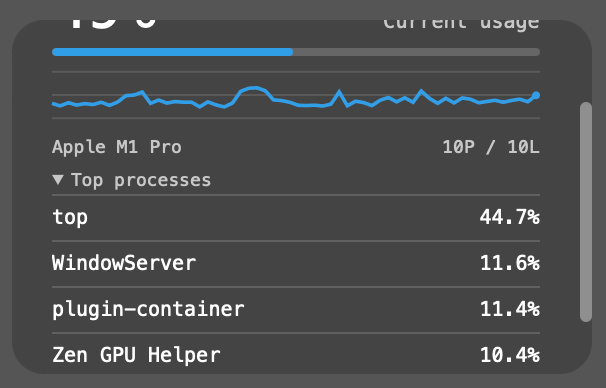
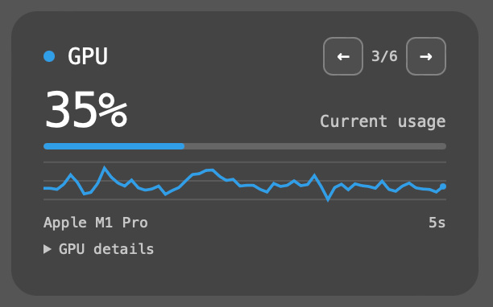
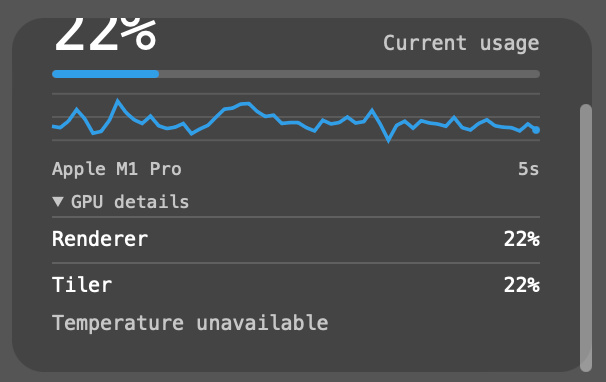
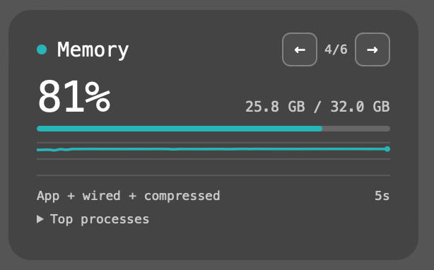
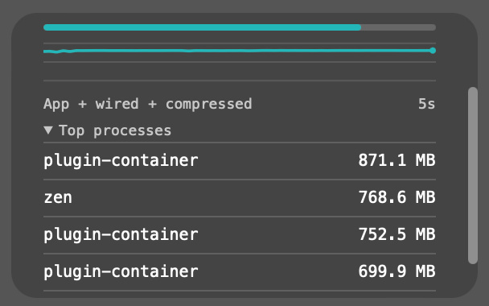
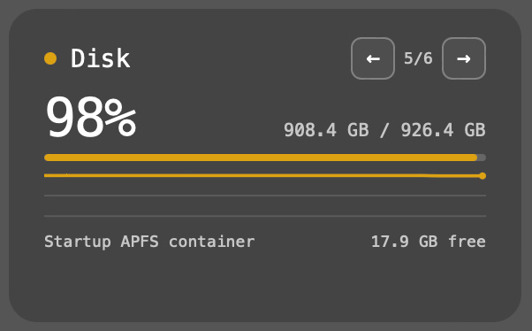
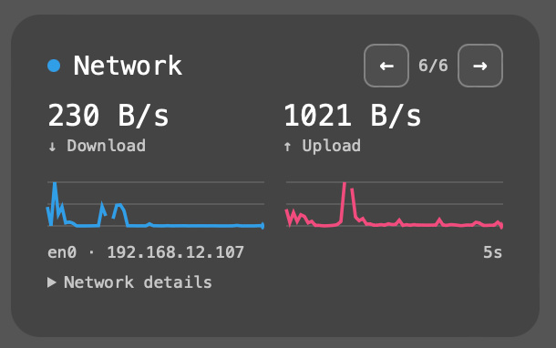
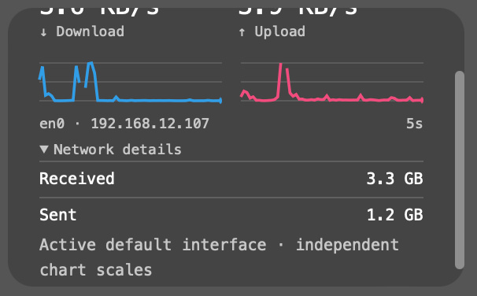

# Übersicht System Monitor

[English](README.md) | [繁體中文](README.zh-TW.md)

[jacklandrin](https://github.com/jacklandrin)이 개발한 [OnlySwitch](https://github.com/jacklandrin/OnlySwitch#system-monitor)의 System Monitor 기능에서 영감을 받은 macOS Übersicht용 소형 시스템 모니터 위젯으로, 화살표 버튼으로 **CPU, GPU, 메모리, 디스크, 네트워크**를 하나씩 전환하거나 개요 화면에서 활성화된 모든 항목을 한눈에 확인할 수 있습니다.

- 실제 사용량, 사용률 막대, 기록 그래프를 표시합니다.
- 프로세스 목록과 GPU·네트워크 상세 정보를 펼쳐 볼 수 있습니다.
- 라이트·다크 모드를 지원하며 색상과 투명도를 설정할 수 있습니다.
- 키보드로 전환할 수 있으며 마지막으로 선택한 항목을 기억합니다.
- 일부 항목을 읽지 못해도 다른 항목은 갱신됩니다. 이전 값에는 오래된 데이터라는 표시가 나타납니다.
- sudo, 백그라운드 서비스, 외부 API, 추가 npm 패키지가 필요하지 않습니다.

## 요구 사항

- macOS 및 `/Applications`에 설치된 Übersicht.
- PATH, `/opt/homebrew/bin` 또는 `/usr/local/bin`에서 실행할 수 있는 Node.js.
- 디스크 모니터링에는 APFS 시동 디스크가 필요합니다. GPU 모니터링에는 지원되는 Apple Silicon Mac 등에서 제공하는 IOAccelerator 사용률 통계가 필요합니다. 통계를 읽을 수 없으면 사용 불가로 표시합니다.

## 설치

macOS, Übersicht, Node.js가 필요합니다. 수집기는 PATH, `/opt/homebrew/bin`, `/usr/local/bin`에서 Node.js를 찾습니다. 다른 위치에 설치했다면 `index.jsx`의 실행 명령을 수정하세요.

[ubersicht-only-system-monitor.widget.zip](ubersicht-only-system-monitor.widget.zip)을 다운로드하고 압축을 푼 뒤, 안에 있는 `ubersicht-only-system-monitor.widget` 폴더를 `~/Library/Application Support/Übersicht/widgets/`에 넣으세요.

터미널에서 바로 설치할 수도 있습니다.

```sh
mkdir -p "$HOME/Library/Application Support/Übersicht/widgets"
curl -fL "https://raw.githubusercontent.com/yozlog/ubersicht-only-system-monitor/main/ubersicht-only-system-monitor.widget.zip" -o /tmp/ubersicht-only-system-monitor.widget.zip
unzip /tmp/ubersicht-only-system-monitor.widget.zip -d "$HOME/Library/Application Support/Übersicht/widgets"
```

설치 후 Übersicht 메뉴에서 **Refresh All Widgets**를 선택하세요.

## 사용 방법

Übersicht가 `index.jsx`를 자동으로 불러옵니다. Übersicht의 위젯 상호작용 기능을 켠 뒤 ← / → 버튼으로 항목을 전환하세요. 카드에 포커스를 둔 상태에서는 키보드의 왼쪽·오른쪽 화살표도 사용할 수 있습니다. Escape를 누르면 카드 포커스가 해제됩니다. 상세 정보를 펼치면 카드 안에서 스크롤할 수 있습니다. 스크롤바는 마우스를 올렸을 때만 표시되며, 컨트롤에 포커스가 남아 있어도 마우스가 벗어나면 숨겨집니다. 카드 자체에는 포커스 테두리가 없지만 버튼과 펼치기 컨트롤에는 키보드 포커스 표시가 유지됩니다.

## 설정

설치한 위젯 디렉터리의 `config.json`을 수정하세요. 프로젝트는 일반적인 기본값을 제공하며 다른 위젯에 의존하지 않습니다.

| 설정 | 기본값 | 설명 |
| --- | --- | --- |
| `top` | 44 | 화면 위쪽에서의 거리(px) |
| `left` | 20 | 화면 왼쪽에서의 거리(px) |
| `width` | 290 | 카드 외부 너비, 최소 240px |
| `minHeight` | 177 | 카드 최소 높이, maxHeight를 넘지 않음 |
| `maxHeight` | 177 | 카드 최대 높이, 넘치는 내용은 스크롤 |
| `refreshInterval` | 5000 | 갱신 간격(ms), 최소 3000 |
| `colors.light` / `colors.dark` | config.json 참고 | 16진수 전경색·배경색과 0–1 범위의 backgroundOpacity |

`minHeight`와 `maxHeight`가 같으면 카드 높이가 고정됩니다. 개인 데스크톱에 맞춘 위치와 색상은 설치본에서 변경하세요.

## 모양과 표시 항목

아래 필드를 설치본의 config.json에 병합하고 기존 위치와 크기를 유지하세요. 이 예시는 기본값으로 다섯 가지 모니터를 모두 활성화합니다.

```json
{
  "fontFamily": ["Input Mono", "Fira Code", "Menlo", "monospace"],
  "fontSize": 12,
  "overview": true,
  "monitors": ["cpu", "gpu", "memory", "disk", "network"],
  "colors": {
    "light": {
      "background": "#ffffff",
      "foreground": "#000000",
      "backgroundOpacity": 0.25
    },
    "dark": {
      "background": "#000000",
      "foreground": "#ffffff",
      "backgroundOpacity": 0.2
    },
    "accents": {
      "cpu": "#329ee8",
      "gpu": "#329ee8",
      "memory": "#23b7b8",
      "disk": "#dca212",
      "network": "#329ee8",
      "upload": "#f24b7d"
    }
  }
}
```

- `monitors`: 표시할 항목과 화살표 전환 순서입니다. `cpu`, `gpu`, `memory`, `disk`, `network`를 지원하며 기본값은 다섯 항목 모두입니다. 중복되거나 알 수 없는 항목은 무시합니다. `[]`는 활성화된 항목이 없다는 안내를 표시합니다. 누락되거나 배열이 아니면 다섯 항목을 모두 사용합니다. 개요를 끄고 상세 화면이 하나만 남으면 화살표가 비활성화됩니다. 설정 변경 후 현재 항목이 여전히 활성화되어 있으면 유지하고, 아니면 첫 번째 항목을 선택합니다. 활성화된 항목만 수집하며 개요와 상세 화면은 같은 측정값을 공유합니다. 항목을 끄면 해당 조회도 중지됩니다.
- `fontFamily`: 설치된 글꼴 이름을 우선순위대로 나열한 배열 또는 단일 글꼴 이름 문자열입니다. 기본 목록은 위 예시와 같습니다. 잘못되거나 빈 이름은 기본값으로 처리하며 글꼴을 다운로드하지 않습니다.
- `fontSize`: 기본 글자 크기(px)이며 범위는 8–24, 기본값은 12입니다. 다른 글자 크기도 비례하여 바뀝니다. 큰 글자를 사용하면 카드를 넓히거나 높이거나 스크롤해야 할 수 있습니다.
- `colors.light` / `colors.dark`: `background`는 배경색, `foreground`는 글자색, `backgroundOpacity`는 투명도입니다. 시스템의 라이트·다크 모드를 따릅니다.
- `colors.accents`: 각 항목의 표시점, 사용률 막대, 그래프 색상입니다. `network`는 다운로드, `upload`는 업로드 색상이며 두 화면 모드에서 공통으로 사용합니다. 글자는 foreground 색상을 사용합니다.

색상은 `#RGB` 또는 `#RRGGBB` 형식을 지원합니다. 잘못된 값은 기본 색상으로 처리합니다. 올바른 JSON을 저장하면 Übersicht가 자동으로 다시 불러와 적용합니다.

## 개요 화면



설치한 위젯 폴더의 `config.json`(기본 경로: `~/Library/Application Support/Übersicht/widgets/ubersicht-only-system-monitor.widget/config.json`)을 열고 `overview` 항목을 수정하세요. `"overview": true`는 각 상세 화면 앞에 간단한 Overview 화면을 추가합니다(기본값). `false`로 설정하면 끌 수 있습니다. 개요는 같은 설정 파일의 `monitors`에 활성화된 항목과 순서를 따릅니다. 목록이 비어 있으면 활성화된 항목이 없다는 안내를 표시합니다. 파일을 저장하면 Übersicht가 자동으로 다시 불러와 적용합니다.

기본 크기 290 × 177px, 기본 글자 크기 12px에서는 다섯 항목을 스크롤 없이 볼 수 있습니다. CPU, GPU, 메모리, 디스크는 백분율과 오른쪽의 작은 사용률 원형 그래프를 표시하며, 네트워크는 다운로드·업로드 속도를 표시합니다. 색상은 `colors.accents`를 따릅니다. 읽을 수 없는 값은 `—`와 빈 원으로 표시하고, 오래된 값은 `!`와 설명 툴팁으로 표시합니다. 개요에는 기록 그래프나 펼치기 목록이 없습니다.

처음 사용할 때는 개요가 표시됩니다. 저장된 화면이 여전히 활성화되어 있으면 해당 화면을 유지합니다. 화살표나 키보드로 상세 화면으로 이동할 수 있습니다. 모니터를 하나만 활성화해도 개요가 켜져 있으면 두 화면을 전환할 수 있습니다.

## 측정값

### CPU

250ms 동안의 CPU 카운터 차이로 전체 시스템 사용률을 계산합니다. P/L은 물리·논리 코어 수입니다. 프로세스 목록은 macOS `ps %cpu` 평균값을 사용하므로 짧은 시스템 샘플과 다르며, 여러 코어를 사용하는 프로세스는 100%를 넘을 수 있습니다.

| 사용률 및 기록 | 프로세스 목록 |
| --- | --- |
|  |  |

### GPU

IOAccelerator의 Device Utilization을 읽습니다. 제공되는 경우 Renderer·Tiler 상세 정보도 표시합니다. CPU·GPU 온도는 수집하지 않습니다.

| 사용률 및 기록 | GPU 상세 정보 |
| --- | --- |
|  |  |

### 메모리

anonymous + wired + compressor 페이지에서 purgeable 페이지를 뺀 값으로 앱·상주·압축 메모리를 추정합니다. 회수 가능한 파일 캐시를 제외하므로 활성 상태 보기와 차이가 날 수 있습니다. 프로세스 메모리는 RSS이며 공유 페이지가 여러 프로세스에 중복 표시될 수 있습니다.

| 사용률 및 기록 | 프로세스 목록 |
| --- | --- |
|  |  |

### 디스크

시동 APFS 컨테이너의 사용량과 전체 용량을 표시합니다. 용량을 공유하는 볼륨과 스냅샷을 포함합니다. 제거 가능한 공간을 이미 확보된 여유 공간으로 계산하지 않으며 외장 디스크는 포함하지 않습니다.



### 네트워크

기본 경로 인터페이스의 바이트 카운터 차이를 경과 시간으로 나눕니다. 최초 측정, 카운터 초기화, 인터페이스 변경, 긴 측정 공백이 발생하면 새로운 기준값이 준비될 때까지 `—`를 표시합니다. 분할 터널 VPN 트래픽은 다른 인터페이스를 사용할 수 있으며 합산하지 않습니다. 다운로드·업로드 그래프의 축척은 각각 조정됩니다.

| 다운로드 및 업로드 기록 | 네트워크 상세 정보 |
| --- | --- |
|  |  |


용량은 1024 단위로 환산하고 KB·MB·GB로 표기합니다. 기록은 최대 60개이며 기본 갱신 간격에서는 약 5분에 해당합니다. 다시 불러오면 기록이 초기화됩니다. 각 외부 명령은 최대 2초 동안 실행되며 중복 수집이 동시에 실행되지 않도록 합니다.

## 수집과 리소스 사용

매번 갱신할 때 `monitors`에서 활성화된 항목만 조회합니다. 목록이 비어 있으면 수집기를 실행하지 않습니다. 활성화된 항목은 다른 화면을 보고 있을 때도 갱신되어 개요와 기록을 최신 상태로 유지합니다. 개요는 같은 측정값을 재사용하며 추가 조회를 실행하지 않습니다. GPU만 활성화한 경우 칩 이름은 읽지만 CPU 사용률을 샘플링하지 않습니다.

CPU와 메모리의 **Top processes** 목록은 현재 상세 화면에서 펼쳐져 있을 때만 조회합니다. 펼치면 이전 목록을 지우고 다음 갱신까지 로딩 안내를 표시합니다. 접거나 화면을 전환하면 이후 프로세스 조회를 중지합니다. 이미 시작한 조회는 완료될 수 있지만 목록이 닫힌 후에는 결과를 반영하지 않습니다. 다른 활성 모니터는 계속 갱신됩니다.

`node collect.cjs`를 직접 실행하면 `config.json`을 따르며 기본적으로 프로세스 목록은 읽지 않습니다. 진단 시 `--monitors=cpu,memory --processes=cpu`로 CPU 프로세스 목록을 요청할 수 있습니다. 비활성 항목의 프로세스 목록은 요청할 수 없습니다.

## 개발 및 검증

```sh
node check.cjs
node collect.cjs
```

검증에는 Node assert와 Übersicht에 포함된 Babel·React를 사용합니다. 측정값 파싱, APFS 용량, GPU 가용성, VPN 카운터, 네트워크 초기화, 오래된 데이터, 기록 개수 제한, 항목 전환, 선택 저장, 중복 수집 방지를 확인합니다. 수집기는 현재 시스템 측정값을 JSON으로 출력합니다. 이 출력은 버전 관리에 커밋하지 마세요.

`node build-archive.cjs`를 실행하면 `ubersicht-only-system-monitor.widget.zip`을 생성합니다. 압축 파일에는 실행 파일, 배포용 기본 설정, 매니페스트, 라이선스만 포함되며 `.widget` 폴더에 맞게 수집기 경로를 조정합니다.

## 라이선스

이 프로젝트는 [The Unlicense](LICENSE)를 사용합니다. 타사 의존성, 서비스, 데이터에는 각각의 라이선스와 약관이 적용됩니다.

## 개발 안내

이 프로젝트는 AI 코드 에이전트의 도움을 받아 개발 및 유지보수됩니다.
