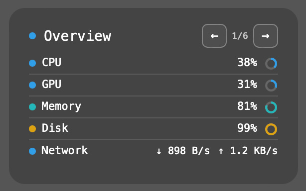
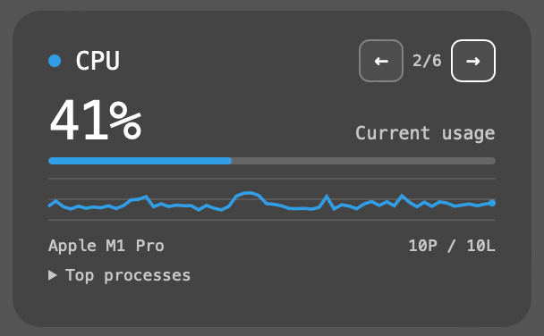
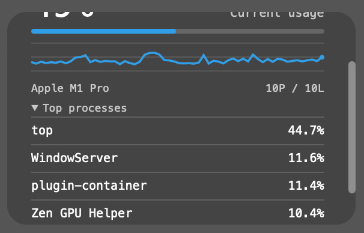
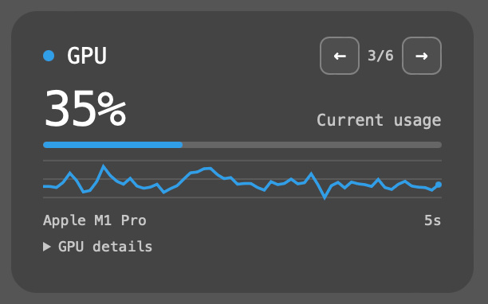
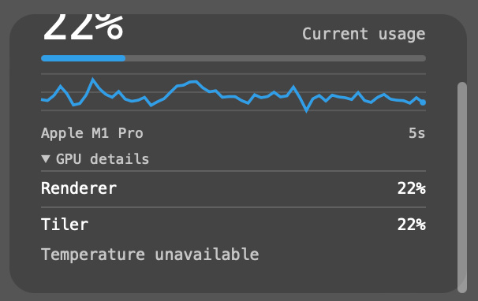
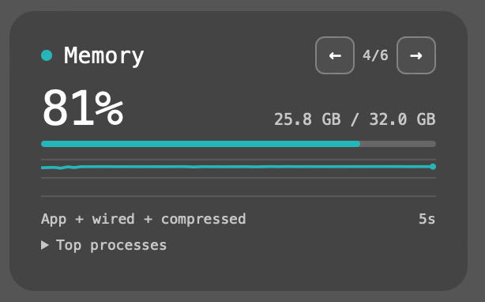
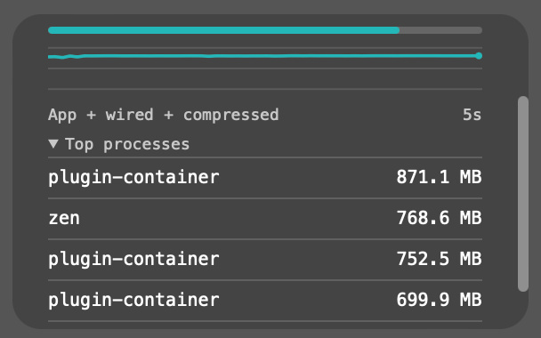
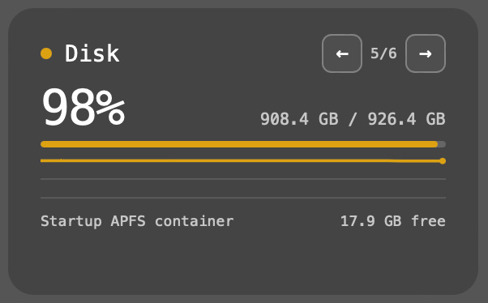
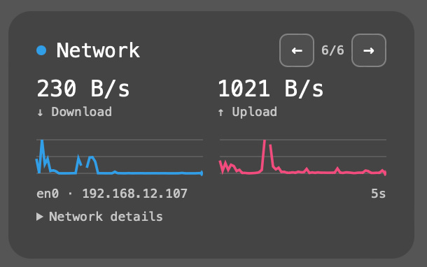
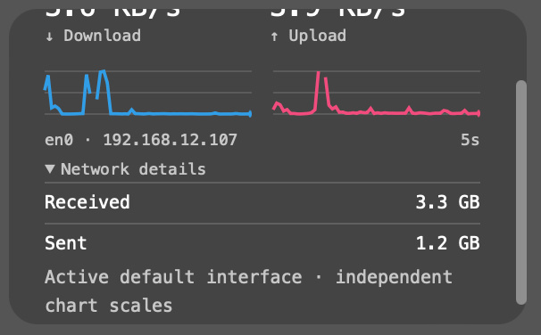

# Übersicht System Monitor

[繁體中文](README.zh-TW.md) | [한국어](README.ko.md)

A compact system monitor widget for Übersicht on macOS, inspired by the System Monitor feature in [OnlySwitch](https://github.com/jacklandrin/OnlySwitch#system-monitor) by [jacklandrin](https://github.com/jacklandrin), with arrow buttons to switch between individual **CPU, GPU, Memory, Disk, and Network** monitors and an Overview page showing all enabled monitors at a glance.

- Real usage readings, progress bars and rolling history charts.
- Expandable process lists and GPU/network details.
- Light and dark appearance, configurable colors and transparency.
- Keyboard navigation and remembered monitor selection.
- Independent metric failures with visible stale-reading indicators.
- No sudo, background daemon, external API or additional npm dependencies.

## Requirements

- macOS with Übersicht installed in `/Applications`.
- Node.js available through PATH, `/opt/homebrew/bin`, or `/usr/local/bin`.
- APFS startup disk for disk monitoring. GPU readings require IOAccelerator utilization statistics, as exposed on supported Apple Silicon Macs; unavailable statistics are labeled accordingly.

## Installation

Requires macOS, Übersicht, and Node.js. The collector searches PATH, `/opt/homebrew/bin`, and `/usr/local/bin` for Node.js; if it is installed elsewhere, update the command in `index.jsx`.

Download and extract [ubersicht-only-system-monitor.widget.zip](ubersicht-only-system-monitor.widget.zip), then place the resulting `ubersicht-only-system-monitor.widget` folder in `~/Library/Application Support/Übersicht/widgets/`.

You can also install directly from Terminal:

```sh
mkdir -p "$HOME/Library/Application Support/Übersicht/widgets"
curl -fL "https://raw.githubusercontent.com/yozlog/ubersicht-only-system-monitor/main/ubersicht-only-system-monitor.widget.zip" -o /tmp/ubersicht-only-system-monitor.widget.zip
unzip /tmp/ubersicht-only-system-monitor.widget.zip -d "$HOME/Library/Application Support/Übersicht/widgets"
```

Then select **Refresh All Widgets** in the Übersicht menu.

## Usage

Übersicht automatically loads `index.jsx`. Enable widget interaction in Übersicht to use the controls. Use ← / → to switch monitors, or focus the card and press the left/right arrow keys. Press Escape to release card focus. Expand details to scroll within the card. The scrollbar appears only while hovering and hides when the pointer leaves, even if a control still has focus. The card itself has no focus outline; buttons and expandable controls retain their keyboard focus indicators.

## Configuration

Edit `config.json` in the installed widget directory. The project ships with general defaults and does not depend on any other widget.

| Setting | Default | Description |
| --- | --- | --- |
| `top` | 44 | Top position in pixels |
| `left` | 20 | Left position in pixels |
| `width` | 290 | Outer width in pixels; minimum 240 |
| `minHeight` | 177 | Minimum outer height, capped by maxHeight |
| `maxHeight` | 177 | Maximum outer height; excess content scrolls |
| `refreshInterval` | 5000 | Refresh interval in milliseconds; minimum 3000 |
| `colors.light` / `colors.dark` | See config.json | Hexadecimal foreground/background colors and backgroundOpacity from 0 to 1 |

Equal minHeight/maxHeight values produce a fixed-height card. Configure personal desktop positions and colors in the installed copy.

## Appearance and visible monitors

Merge these fields into your installed config.json, preserving position and size. This example enables all five monitors by default:

```json
{
  "fontFamily": ["Input Mono", "Fira Code", "Menlo", "monospace"],
  "fontSize": 12,
  "overview": true,
  "monitors": ["cpu", "gpu", "memory", "disk", "network"],
  "splitMonitors": false,
  "splitDirection": "vertical",
  "colors": {
    "light": {
      "background": "#ffffff",
      "foreground": "#000000",
      "backgroundOpacity": 0.25
    },
    "dark": {
      "background": "#000000",
      "foreground": "#ffffff",
      "backgroundOpacity": 0.2
    },
    "accents": {
      "cpu": "#329ee8",
      "gpu": "#329ee8",
      "memory": "#23b7b8",
      "disk": "#dca212",
      "network": "#329ee8",
      "upload": "#f24b7d"
    }
  }
}
```

- `monitors`: Enabled pages in switching order. Supported identifiers: `cpu`, `gpu`, `memory`, `disk`, `network`. The default enables all five. Duplicates and unknown identifiers are ignored; `[]` shows a no-monitors message. A missing or non-array value enables all five. The arrows are disabled only when a single detail page remains and Overview is off. Selection is retained across configuration changes if still enabled, otherwise the first enabled page is selected. Only enabled monitors are collected. Overview and detail pages share the same samples; hiding a monitor stops its queries.
- `splitMonitors`: When `true`, every enabled monitor is shown at once as its own tile instead of a single paged card. Default `false`. Split mode has no arrows, page selection or Overview page (`overview` is ignored); each tile uses the configured `width`, `minHeight` and `maxHeight`. Only one Top processes list (CPU or Memory) can be open at a time.
- `splitDirection`: Tile layout when `splitMonitors` is `true`: `"vertical"` (default) stacks tiles in a column; `"horizontal"` places them side by side in a row. Ignored when `splitMonitors` is `false`.
- `fontFamily`: Ordered list of installed font names, or a single font name. The default list is shown above. Unsupported or empty names fall back to defaults. Fonts are not downloaded.
- `fontSize`: Base size in pixels, from 8 to 24; default 12. Other text scales proportionally. Larger text may need a wider/taller card or scrolling.
- `colors.light` / `colors.dark`: `background` sets the background, `foreground` sets text, and `backgroundOpacity` sets transparency. The active palette follows system appearance.
- `colors.accents`: Colors for each monitor's indicator, bar and graph. `network` is the download color; `upload` is the upload color. Accent colors apply to both appearances. Text uses the foreground color.

Colors accept `#RGB` or `#RRGGBB`; invalid values fall back to defaults. Save valid JSON to apply changes through Übersicht's automatic reload.

## Overview



Open `config.json` in the installed widget folder (default path: `~/Library/Application Support/Übersicht/widgets/ubersicht-only-system-monitor.widget/config.json`) and edit the `overview` field: `"overview": true` enables the compact Overview page before the individual monitors (default). Set it to `false` to keep only the detail pages. It uses the enabled `monitors` list and its order from the same file; an empty list still shows the no-monitors message. Save the file and Übersicht automatically reloads the settings.

At the default 290 × 177px size and 12px base font, all five enabled items fit without scrolling. CPU, GPU, Memory and Disk show percentages with small usage rings on the right; Network shows download/upload rates. Colors follow `colors.accents`. Unavailable values show `—` with empty ring tracks, and stale readings are marked `!` with an explanatory tooltip. Overview contains no history charts or expandable lists.

With `splitMonitors` enabled, Overview is not shown; see [Appearance and visible monitors](#appearance-and-visible-monitors).

Fresh sessions start on Overview; an existing saved page is retained if still enabled. Use the arrows or keyboard to reach individual detail pages. A single enabled monitor still has two pages when Overview is enabled.

## Metrics

### CPU

Whole-machine usage from a 250ms sample of CPU counters. P/L identifies physical/logical cores. The top-process list uses macOS `ps %cpu` averages, which differ from the short system sample and may exceed 100% for multicore processes.

| Usage and history | Top processes |
| --- | --- |
|  |  |

### GPU

IOAccelerator Device Utilization, with Renderer/Tiler details where available. CPU/GPU temperature is not collected.

| Usage and history | GPU details |
| --- | --- |
|  |  |

### Memory

Approximate app + wired + compressed memory, calculated from anonymous + wired + compressor pages minus purgeable pages. Excludes reclaimable file cache; may differ from Activity Monitor. Process memory is RSS, so shared pages may appear in multiple processes.

| Usage and history | Top processes |
| --- | --- |
|  |  |

### Disk

Used/total capacity of the startup APFS container, including its shared volumes and snapshots. Purgeable space is not counted as already free. External disks are not included.



### Network

Byte-counter differences over elapsed time for the default-route interface. The first sample, a counter reset, an interface change or a long sampling gap displays `—` until a new baseline is available. Split-tunnel VPN traffic may use other interfaces and is not aggregated. Download/upload charts scale independently.

| Download and upload history | Network details |
| --- | --- |
|  |  |


Capacity units use powers of 1024 with KB/MB/GB labels. History holds up to 60 samples, about five minutes at the default refresh interval; it resets on reload. Individual command execution is limited to two seconds and overlapping collection is prevented.

## Collection and resource usage

Only monitors enabled in `monitors` are queried at each refresh. An empty list launches no collector. The enabled monitors continue updating while another page is visible so their overview values and histories stay current. Overview reuses those samples without launching extra queries. GPU-only mode reads the chip name without enabling CPU usage sampling.

CPU and Memory process lists are queried only while their **Top processes** section is expanded on the active detail page. Expanding clears the previous list and shows a loading message until the next refresh; collapsing or switching pages stops subsequent process queries. A query already in progress may finish, but its results are ignored after the list is closed. Other enabled monitor readings keep updating.

Running `node collect.cjs` follows `config.json` and does not collect process lists by default. For diagnostics, `--monitors=cpu,memory --processes=cpu` explicitly requests the CPU process list; disabled monitors cannot request a process list.

## Development

```sh
node check.cjs
node collect.cjs
```

The checks use Node assert plus Übersicht's bundled Babel and React. They cover metric parsing, APFS capacity, GPU availability, VPN counters, network resets, stale data, bounded history, navigation, saved selection and collection concurrency. The collector prints current system readings as JSON; avoid committing this output.

Run `node build-archive.cjs` to create `ubersicht-only-system-monitor.widget.zip`. The archive contains only runtime files, the public default configuration, the manifest, and the license; it adjusts the collector path for the `.widget` folder.

## License

This project uses [The Unlicense](LICENSE). Third-party dependencies, services, and data remain subject to their respective licenses and terms.

## Development Statement

This project is developed and maintained with assistance from an AI code agent.
