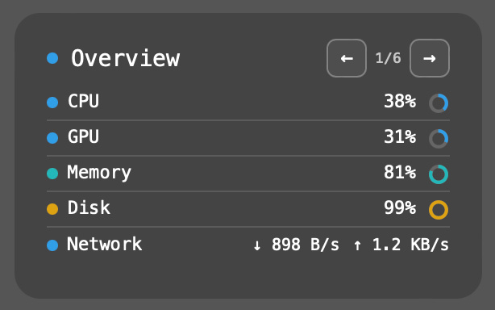
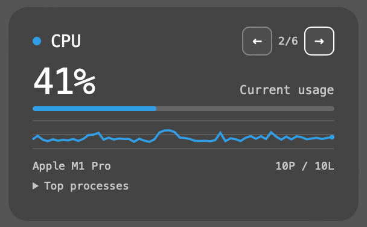
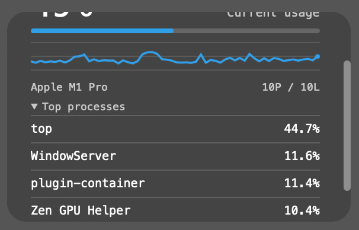
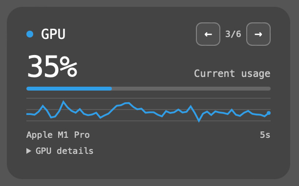
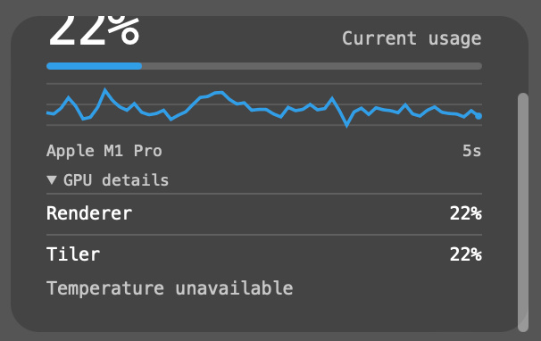
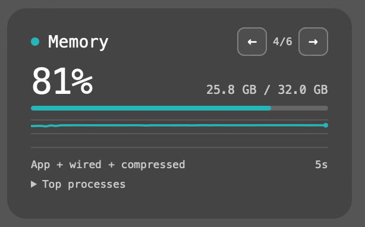
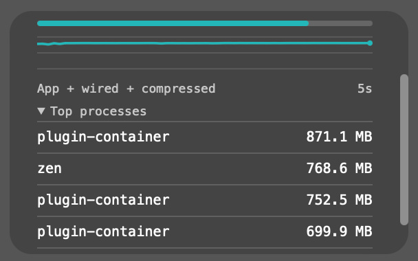
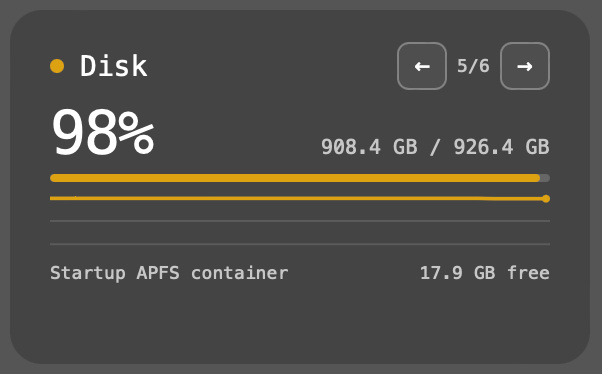
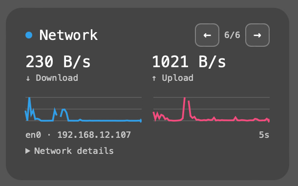
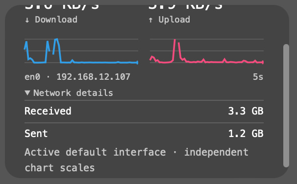

# Übersicht System Monitor

[English](README.md) | [한국어](README.ko.md)

這是一款受 [jacklandrin](https://github.com/jacklandrin) 開發的 [OnlySwitch](https://github.com/jacklandrin/OnlySwitch#system-monitor) 中 System Monitor 功能啟發、適用於 macOS Übersicht 的精簡系統監控 widget，可一次顯示一個監控項目，透過箭頭切換 **CPU、GPU、記憶體、磁碟與網路**，也提供總覽頁面，一次查看所有已啟用的監控項目。

- 真實使用率、進度條與歷史曲線。
- 可展開的程序清單，以及 GPU／網路詳細資訊。
- 支援明暗模式，可調整顏色與透明度。
- 支援鍵盤切換，並記住上次選擇的監控頁面。
- 個別監控讀取失敗時不影響其他項目，舊讀值會標示為過期。
- 不需要 sudo、背景服務、外部 API 或額外 npm 套件。

## 系統需求

- macOS，且 Übersicht 安裝於 `/Applications`。
- Node.js 可透過 PATH、`/opt/homebrew/bin` 或 `/usr/local/bin` 找到。
- 磁碟監控需要 APFS 啟動磁碟。GPU 監控需要 IOAccelerator 提供使用率統計，例如支援此功能的 Apple Silicon Mac；無法取得時會標示不可用。

## 安裝

需要 macOS、Übersicht 與 Node.js。採集器會從 PATH、`/opt/homebrew/bin` 與 `/usr/local/bin` 尋找 Node.js；若安裝在其他位置，請修改 `index.jsx` 中的執行指令。

下載並解壓縮 [ubersicht-only-system-monitor.widget.zip](ubersicht-only-system-monitor.widget.zip)，將其中的 `ubersicht-only-system-monitor.widget` 資料夾放入 `~/Library/Application Support/Übersicht/widgets/`。

也可在終端機直接安裝：

```sh
mkdir -p "$HOME/Library/Application Support/Übersicht/widgets"
curl -fL "https://raw.githubusercontent.com/yozlog/ubersicht-only-system-monitor/main/ubersicht-only-system-monitor.widget.zip" -o /tmp/ubersicht-only-system-monitor.widget.zip
unzip /tmp/ubersicht-only-system-monitor.widget.zip -d "$HOME/Library/Application Support/Übersicht/widgets"
```

完成後，在 Übersicht 選單選擇 **Refresh All Widgets**。

## 使用

Übersicht 會自動載入 `index.jsx`。先開啟 Übersicht 的 widget 互動功能，再使用 ← / → 切換監控項目；也可以聚焦卡片後按鍵盤左右方向鍵。按 Escape 可移除卡片焦點。展開詳細資訊後，可在卡片內捲動。捲動條僅在滑鼠移入時顯示，移開後隱藏，即使控制項仍保有焦點也不會持續顯示。卡片本身不顯示焦點外框；按鈕與展開控制項保留鍵盤焦點提示。

## 設定

編輯安裝目錄裡的 `config.json`。專案提供通用預設值，不依賴其他 widget。

| 設定 | 預設值 | 說明 |
| --- | --- | --- |
| `top` | 44 | 距離畫面頂端的像素數 |
| `left` | 20 | 距離畫面左側的像素數 |
| `width` | 290 | 外框寬度，最小 240px |
| `minHeight` | 177 | 外框最小高度，不超過 maxHeight |
| `maxHeight` | 177 | 外框最大高度，超出內容可捲動 |
| `refreshInterval` | 5000 | 更新間隔，單位 ms，最小 3000 |
| `colors.light` / `colors.dark` | 見 config.json | 十六進位前景色、背景色，以及 0–1 的 backgroundOpacity |

`minHeight` 與 `maxHeight` 相同時，卡片採用固定高度。個人桌面位置與配色請在安裝目錄調整。

## 外觀與顯示項目

將以下欄位合併到安裝目錄的 config.json，保留原有位置與尺寸。這個範例預設啟用全部五種監控：

```json
{
  "fontFamily": ["Input Mono", "Fira Code", "Menlo", "monospace"],
  "fontSize": 12,
  "overview": true,
  "monitors": ["cpu", "gpu", "memory", "disk", "network"],
  "colors": {
    "light": {
      "background": "#ffffff",
      "foreground": "#000000",
      "backgroundOpacity": 0.25
    },
    "dark": {
      "background": "#000000",
      "foreground": "#ffffff",
      "backgroundOpacity": 0.2
    },
    "accents": {
      "cpu": "#329ee8",
      "gpu": "#329ee8",
      "memory": "#23b7b8",
      "disk": "#dca212",
      "network": "#329ee8",
      "upload": "#f24b7d"
    }
  }
}
```

- `monitors`：要顯示的頁面，陣列順序就是箭頭切換順序。支援 `cpu`、`gpu`、`memory`、`disk`、`network`，預設啟用全部五項。重複與未知項目會忽略；`[]` 顯示未啟用監控的提示。未設定或不是陣列時使用全部五項。只有一個詳細頁且關閉總覽時，才停用箭頭。修改清單後，目前頁面若仍啟用就保留，否則切到第一個啟用項目。只會採集已啟用的監控項目，總覽與詳細頁共用讀值；停用項目會停止對應查詢。
- `fontFamily`：依優先順序排列的已安裝字型名稱，也可填單一字型名稱字串。預設清單如上。無效或空白名稱會退回預設值，不會下載字型。
- `fontSize`：基準字級，單位 px，範圍 8–24，預設 12。其他文字依比例縮放；放大字級可能需要加寬、加高卡片或捲動。
- `colors.light` / `colors.dark`：`background` 設定背景色、`foreground` 設定文字色、`backgroundOpacity` 設定透明度，會跟隨系統明暗模式切換。
- `colors.accents`：各監控項目的圓點、進度條與曲線顏色。`network` 是下載色，`upload` 是上傳色，兩種明暗模式共用。文字使用 foreground 顏色。

色碼支援 `#RGB` 或 `#RRGGBB`，無效值會退回預設色。儲存有效的 JSON 後，Übersicht 會自動重新載入並套用。

## 總覽頁



開啟安裝資料夾內的 `config.json`（預設路徑：`~/Library/Application Support/Übersicht/widgets/ubersicht-only-system-monitor.widget/config.json`），修改 `overview` 欄位：`"overview": true` 預設啟用精簡的 Overview 總覽頁，放在各監控詳細頁之前；設為 `false` 可關閉。總覽遵循同一份設定檔中 `monitors` 啟用的項目與排列順序，空清單仍會顯示未啟用監控的提示。儲存檔案後，Übersicht 會自動重新載入並套用。

在預設 290 × 177px、基準字級 12px 的卡片內，五項全開也不需捲動。CPU、GPU、記憶體與磁碟顯示百分比，右側附上對應使用率的小圓環；網路顯示下載／上傳速率。顏色沿用 `colors.accents`。無法取得的數值顯示 `—` 與空圓環，過期讀值以 `!` 標記並提供滑鼠提示。總覽不放歷史曲線或展開清單。

首次使用會顯示總覽；已儲存的頁面若仍啟用則保留。透過箭頭或鍵盤可切到各項詳細頁。即使只啟用一個監控項目，開啟總覽後仍有兩頁可切換。

## 監控數值

### CPU

以 250ms 的 CPU 計數器差值計算整台機器的使用率。P/L 代表實體／邏輯核心數。程序清單使用 macOS `ps %cpu` 的平均值，與短時間系統取樣不同；多核心程序可能超過 100%。

| 使用率與歷史曲線 | 程序清單 |
| --- | --- |
|  |  |

### GPU

讀取 IOAccelerator 的 Device Utilization，並在可取得時提供 Renderer／Tiler 詳細資訊。不採集 CPU／GPU 溫度。

| 使用率與歷史曲線 | GPU 詳細資訊 |
| --- | --- |
|  |  |

### 記憶體

使用 anonymous + wired + compressor 頁數減去 purgeable 頁數，估算應用程式、常駐與壓縮記憶體。排除可回收的檔案快取，可能與「活動監視器」略有差異。程序記憶體為 RSS，共享頁面可能重複出現在不同程序中。

| 使用率與歷史曲線 | 程序清單 |
| --- | --- |
|  |  |

### 磁碟

顯示啟動 APFS container 的已用／總容量，包含共用容量的卷宗與快照。可清除空間不視為已釋放空間，不包含外接磁碟。



### 網路

使用預設路由介面的位元組計數器差值除以經過時間。首次取樣、計數器重置、介面切換或取樣中斷過久時，會顯示 `—`，直到建立新的計算基準。分流 VPN 的流量可能經由其他介面，不會合併計算。下載與上傳曲線各自縮放。

| 下載與上傳歷史曲線 | 網路詳細資訊 |
| --- | --- |
|  |  |


容量使用 1024 進位，標示為 KB／MB／GB。歷史最多保留 60 筆，在預設更新間隔下約為五分鐘；重新載入後重新累積。每個外部命令最多執行兩秒，並避免重複採集同時執行。

## 採集與資源使用

每次更新只查詢 `monitors` 中啟用的項目；空清單不會啟動採集器。已啟用項目即使不是目前頁面，也會繼續更新，讓總覽與歷史曲線保持最新。總覽直接共用讀值，不額外查詢。只啟用 GPU 時，會讀取晶片名稱，但不進行 CPU 使用率取樣。

CPU 與記憶體的 **Top processes** 程序清單，只有在目前詳細頁展開時才會查詢。展開時會清除舊清單，顯示載入提示，並於下次更新取得資料；收合或切頁後停止後續程序查詢。已經開始的查詢可能會完成，但清單關閉後不會套用其結果。其他已啟用監控項目仍持續更新。

直接執行 `node collect.cjs` 會依照 `config.json` 採集，預設不讀程序清單。診斷時可使用 `--monitors=cpu,memory --processes=cpu` 明確要求 CPU 程序清單；未啟用的監控項目不能要求程序清單。

## 開發與驗證

```sh
node check.cjs
node collect.cjs
```

檢查使用 Node assert，以及 Übersicht 附帶的 Babel 與 React，涵蓋監控資料解析、APFS 容量、GPU 可用性、VPN 計數器、網路重置、過期資料、歷史上限、切頁、選擇儲存與採集防重複。採集器會輸出目前系統讀值的 JSON，請勿將這些輸出提交到版本控制。

執行 `node build-archive.cjs` 可建立 `ubersicht-only-system-monitor.widget.zip`。壓縮檔只包含執行檔案、公開預設設定、manifest 與授權，並會調整 `.widget` 資料夾的採集器路徑。

## 授權

本專案採用 [The Unlicense](LICENSE)。第三方相依套件、服務與資料各自適用其授權及條款。

## 開發聲明

本專案由 AI code agent 協助開發及維護。
